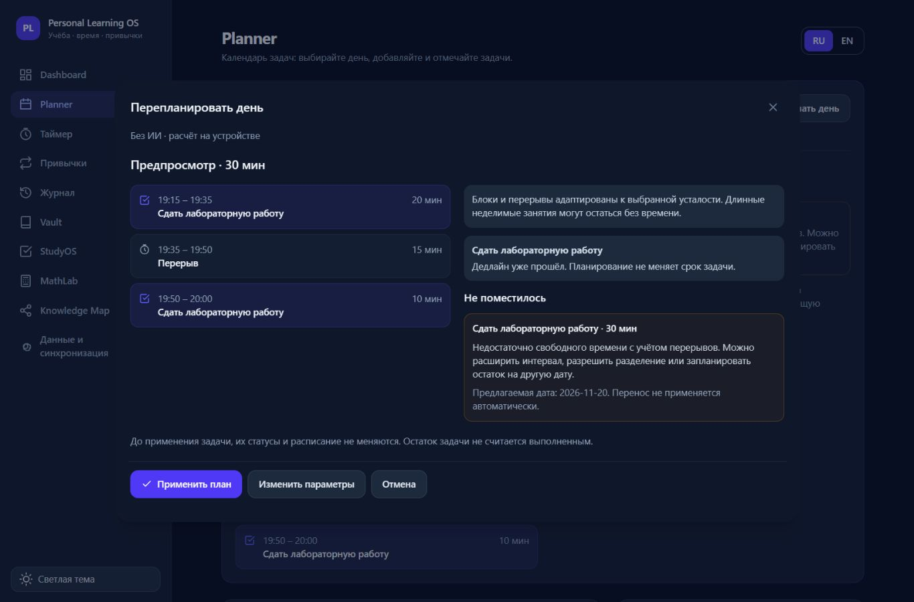

# Personal Learning OS

**English** | [Русский](README.ru.md)

A personal study workspace for tasks, calendars, planning, habits, notes, and focus sessions.

A personal project under active development, built with substantial AI assistance. The first publication is planned as a **prerelease**; compatibility with every device is not guaranteed.



## Download

Open [Releases](https://github.com/Xirikai/personal-learning-os/releases) and download **Personal-Learning-OS-Windows-v0.3.1.zip**. Extract the ZIP and run the EXE inside. End users do not need Node.js.

The same release includes a separate ZIP containing a test Android APK. Extract it on your phone and open the APK. Android 7 or newer is required.

GitHub's **Source code** downloads contain the development sources. The ready-to-run applications are in the platform ZIPs. Download links will become available after the repository and its first release are published.

## Features

- Tasks, month/week/day calendars, events, and recurrence.
- On-device day replanning based on available time and breaks.
- Pomodoro, a study journal, habits, and weekly goals.
- Notes, review flashcards, MathLab, and Knowledge Map.
- Local statistics and JSON backups.
- Optional synchronization through your own Supabase project.
- A shared web foundation for Windows and Android.

## Run from source

Requirements: Node.js 22+.

```powershell
npm ci
npm run dev
```

The web version runs at http://localhost:3000. For a separate Windows application window, first run `npm run build`, then `npm run setup` and `npm run desktop:dev`.

If npm did not run Electron's installation script automatically, `npm run setup` downloads the official runtime.

## Build for Windows

```powershell
npm run setup
npm run desktop:build
```

The output is saved to `release/`.

## Android

Requirements: JDK 21, Android SDK 36, and the `JAVA_HOME` and `ANDROID_HOME` environment variables. After `npm ci`, run:

```powershell
npm run android:sync
./android/gradlew.bat -p android --no-daemon assembleDebug
```

APK output: `android/app/build/outputs/apk/debug/app-debug.apk`. This uses a debug signature for testing. Never commit signing keys to Git. Updating an Android application requires the same signing key and `applicationId`; export your data before uninstalling an existing version.

## Checks

```powershell
npm test
npm run typecheck
npm run test:database
```

All 57 automated checks, TypeScript checking, and the static build passed. A separate local PostgreSQL check covered the fresh Supabase schema, access controls for two users, and stale-write protection. The live cloud project was not changed.

GitHub Actions checks are configured to run after publication. Successful local checks do not imply that the not-yet-run GitHub workflows have passed.

## Data and limitations

- Public EXE/APK builds work locally and are not connected to the author's cloud project.
- Automatic synchronization requires your own Supabase configuration and rebuilding both platforms. JSON backups can be transferred without cloud services.
- The Android APK is a test debug build, not a Google Play release.
- The EXE is not code-signed. Automatic updates are not implemented.

Data is stored in `localStorage`. Export JSON backups through the application settings. Cloud setup is described in [CLOUD-SETUP.md, in Russian](docs/CLOUD-SETUP.md). Public builds do not contain the URL or key of the author's personal Supabase project.

## Development process

The author selected features, tested workflows, identified usability issues, and refined requirements. AI produced a substantial part of the code, documentation, and technical decisions. This is a learning project; independent expertise in every technology used is not claimed.

## Feedback

When opening an Issue, include the steps to reproduce, expected and actual behavior, the application version, and your Windows or Android version. Do not attach personal backups, passwords, or keys.

## Licenses

Original project code is licensed under [MIT](LICENSE). Third-party components retain their own licenses: see [THIRD-PARTY.md, in Russian](THIRD-PARTY.md) and the notices in `licenses/`. Dependency versions are recorded in `package-lock.json`.

Supporting build and user guides are currently in Russian.
