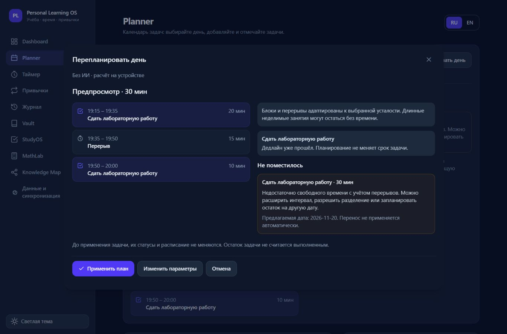

# Personal Learning OS

[English](README.md) | **Русский**

Личная система для учёбы: задачи, календарь, планирование, привычки, заметки и фокус.

Личный проект в развитии, созданный с помощью ИИ. Первая публикация предлагается как **предварительный релиз**, без обещания работы на всех устройствах.



## Скачать приложение

Откройте [Releases](https://github.com/Xirikai/personal-learning-os/releases) и скачайте **Personal-Learning-OS-Windows-v0.3.1.zip**. Распакуйте ZIP и запустите EXE внутри; Node.js пользователю не нужен.

Для Android в том же релизе есть отдельный ZIP с тестовым APK. Распакуйте его на телефоне и откройте APK. Требуется Android 7 или новее.

GitHub-файлы **Source code** — исходники для разработки, готовое приложение находится в ZIP с названием платформы. Ссылки начнут работать после первой публикации репозитория и релиза.

## Возможности

- Задачи, месячный/недельный/дневной календарь, события и повторения.
- Перепланирование дня на устройстве с учётом доступного времени и перерывов.
- Pomodoro, журнал занятий, привычки и недельные цели.
- Заметки, учебные карточки для повторения, MathLab и Knowledge Map.
- Локальная статистика и резервные копии JSON.
- Опциональная синхронизация через собственный проект Supabase.
- Общая веб-основа для Windows и Android.

## Запуск из исходников

Нужен Node.js 22+.

```powershell
npm ci
npm run dev
```

Веб-версия: http://localhost:3000. Для отдельного окна Windows: сначала `npm run build`, затем `npm run setup` и `npm run desktop:dev`.

Если npm не выполнил установочный скрипт Electron автоматически, команда `npm run setup` загрузит официальный runtime.

## Сборка Windows

```powershell
npm run setup
npm run desktop:build
```

Результат появляется в `release/`. 

## Android

Нужны JDK 21, Android SDK 36 и переменные JAVA_HOME, ANDROID_HOME. После `npm ci`:

```powershell
npm run android:sync
./android/gradlew.bat -p android --no-daemon assembleDebug
```

APK: `android/app/build/outputs/apk/debug/app-debug.apk`. Это debug-подпись для тестирования. Ключ подписи нельзя помещать в Git. Для обновления Android-приложения нужны прежний ключ и тот же applicationId; перед удалением приложения экспортируйте данные.

## Проверки

```powershell
npm test
npm run typecheck
npm run test:database
```

57 автоматических проверок, TypeScript и статическая сборка прошли. Отдельно в локальном PostgreSQL проверены свежая схема Supabase, права двух пользователей и защита от устаревших записей. Живой облачный проект не изменялся.

В репозитории предусмотрены автоматические проверки GitHub Actions. Они начнут выполняться после публикации. Локальная проверка не означает успешный запуск ещё не выполненного CI.

## Данные и ограничения

Публичные EXE/APK работают локально и не подключены к облаку автора. Для автоматической синхронизации нужна собственная настройка Supabase и пересборка обеих платформ. JSON можно переносить без облака. Android APK — тестовая debug-сборка, не публикация в Google Play. EXE без сертификата подписи; автоматических обновлений нет.

Данные сохраняются в localStorage. Экспортируйте JSON через настройки; облако описано в [CLOUD-SETUP.md](docs/CLOUD-SETUP.md). Публичная сборка не содержит адреса и ключа личного Supabase-проекта автора.

## Как создавался проект

Автор выбирал функции, проверял сценарии использования, находил неудобства и уточнял требования. ИИ подготовил значительную часть кода, документации и технических решений. Это первый практический опыт создания приложения; самостоятельное знание всех используемых технологий не заявляется.

## Обратная связь

В Issues опишите действия, ожидаемый и фактический результат, версию приложения и Windows/Android. Не прикладывайте личные резервные копии, пароли или ключи.

## Лицензии

Новый код проекта — [MIT](LICENSE). У сторонних компонентов собственные лицензии: [THIRD-PARTY.md](THIRD-PARTY.md), тексты в `licenses/`. Версии зависимостей закреплены в `package-lock.json`.
